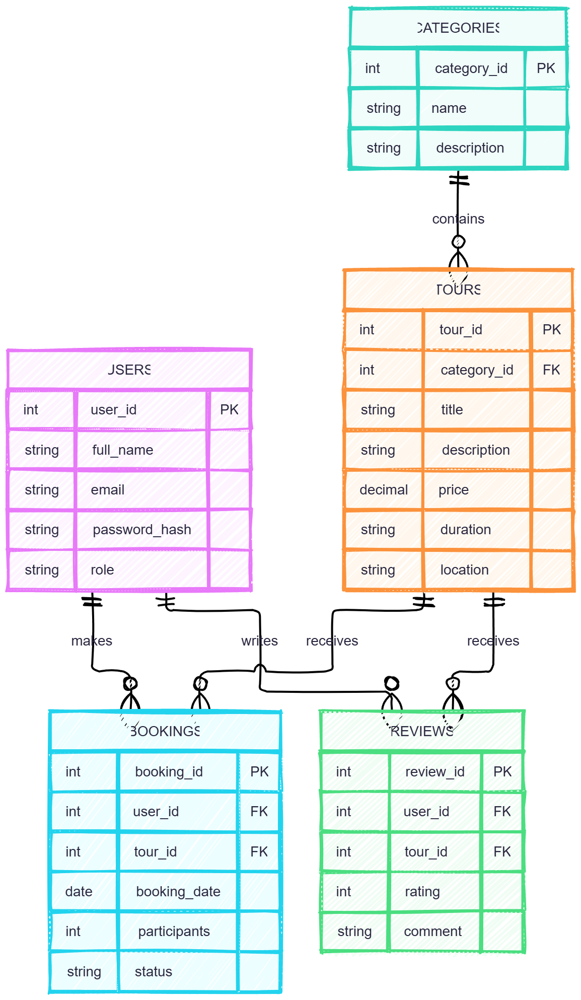

# RaftBook – Adventure Tour Booking System

## Project Description


RaftBook is a web application designed for exploring and booking outdoor adventures in the Foča region of Bosnia and Herzegovina.

The application focuses on activities such as rafting on the Tara River, mountain hiking, and canyoning.

The goal of the project is to make it easier for tourists to discover available adventures and manage their bookings online.

## Technologies

- HTML5 – page structure
- CSS3 – styling and responsive design
- JavaScript – SPA navigation and dynamic content
- PHP with FlightPHP – planned REST API
- MySQL – planned database

## Main Features

### Implemented in Milestone 1

- Home page with an adventure-themed design
- Tour listings
- Individual tour details
- Login and registration forms (UI only)
- Dashboard preview
- My Bookings and My Profile placeholder pages
- Responsive layout
- Single Page Application navigation

### Planned for Future Milestones

- User authentication and authorization
- Tour booking and reservation management
- Database integration
- Admin management of tours
- Reviews and ratings
- Weather information using an external API

## User Roles

**Guest:** Can browse tours, view tour details, and access registration and login pages.

**Registered User:** Will be able to make bookings, view reservations, and manage a personal profile.

**Admin:** Will be able to manage tours, categories, and bookings.

## Database Design

The planned database contains five main entities:

1. Users
2. Categories
3. Tours
4. Bookings
5. Reviews

## Project Structure

```text
raftbook/
├── frontend/
│   ├── assets/
│   ├── css/
│   │   └── style.css
│   ├── js/
│   │   └── app.js
│   ├── views/
│   └── index.html
├── backend/
│   ├── routes/
│   ├── services/
│   ├── dao/
│   ├── middleware/
│   ├── config/
│   └── logs/
├── docs/
│   ├── AI_LOG.md
│   └── ERD.svg
├── .gitignore
├── AGENTS.md
└── README.md
```

## How to Run

1. Download or clone the repository.
2. Open the `frontend` folder.
3. Open `index.html` in a web browser.
4. Navigate through the application using the navigation links.

Note: This is a static frontend prototype. Login,
registration, and booking features are not connected
to a backend or database yet.

## Project Status

Milestone 1 – Static frontend prototype and initial project structure.

## Author

International Burch University – Web Programming Course
